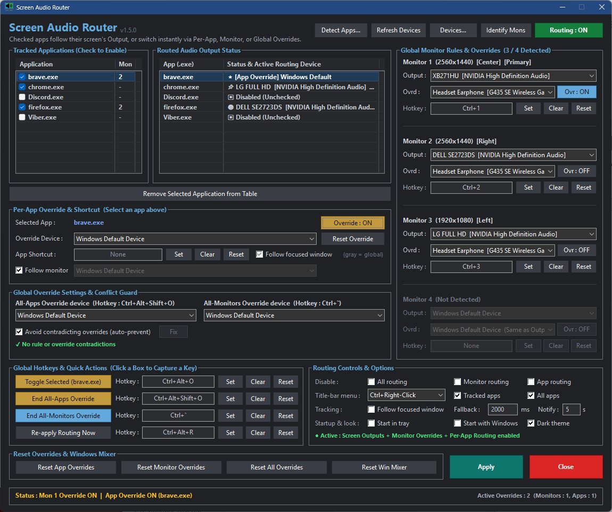
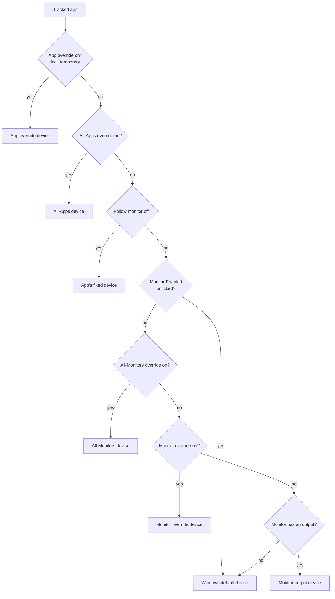
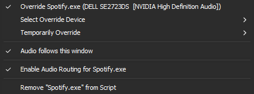

# Screen Audio Router

**Send each app's sound to the speakers or headphones of the monitor its window is on, and its microphone along with it.**

Drag Spotify to your TV and its music plays on the TV. Drag it back to your desk monitor and it plays on your desk speakers. Put on your headset, press a hotkey, and Discord switches to the headset's speaker *and* its microphone. Every tracked app follows its own window, and you can override any of it with a hotkey or from a window's title bar.

Screen Audio Router is a small Windows tray app written in [AutoHotkey v2](https://www.autohotkey.com/). It needs no driver and no virtual audio cable. It uses the same per-app output and input settings you find in Windows *Settings → Sound → Volume mixer*, and changes them automatically.



---

## Contents

- [Features](#features)
- [How it works](#how-it-works)
- [Requirements](#requirements)
- [Installation](#installation)
- [Quick start](#quick-start)
- [Using Screen Audio Router](#using-screen-audio-router)
- [Microphones](#microphones)
- [Hotkeys](#hotkeys)
- [Settings and files](#settings-and-files)
- [Customizing colors](#customizing-colors)
- [Running and compiling from source](#running-and-compiling-from-source)
- [Troubleshooting](#troubleshooting)
- [Known limitations](#known-limitations)
- [Credits](#credits)
- [License](#license)

---

## Features

- **Audio follows the window.** Give each monitor an output device. When a tracked app's window moves to another monitor, its sound moves with it.
- **Microphones follow too.** Pair a microphone with each output device. Apps use the microphone of the device they play on, or a microphone override of their own. See [Microphones](#microphones).
- **Works with any app.** You choose which apps it manages, and every other app is left alone.
- **No rule means Windows default.** A monitor without an output device, or one you switch off with its **Enabled** box, plays on the Windows default device.
- **Overrides with hotkeys:**
  - **Focused app.** Send the app you are using to another device.
  - **All apps.** Send every tracked app to one device.
  - **All monitors.** Make every monitor play on one device.
  - **One monitor or one app.** Give any monitor or app its own hotkey.

  Pressing the hotkey again ends the override. The app then goes to the device of the monitor it is on *now*.
- **Temporary override.** Use another device until the override ends, without changing the saved one.
- **Follow monitor on or off, per app.** Pin an app to one device wherever its window is.
- **Title-bar menu.** Ctrl+Right-Click on any window's title bar (the mouse combination is selectable) to:
  - add the app;
  - pick its override or temporary device;
  - choose which of its windows the sound follows.
- **Apps with several windows** (browsers, for example). The sound follows the first window, a window you pick, or the window you used last.
- **Minimized and tray apps.** An app that is already minimized, or closed to the tray, when Screen Audio Router starts still gets the device of the monitor its window will come back to.
- **One clear table.** Every tracked app in one list: where it plays (monitor or override), its output device and its microphone. Apps with an override on are colored.
- **Missing device handling:**
  - A warning, with an optional sound, when an assigned device is unplugged.
  - A fallback in the meantime: override → monitor output → Windows default.
  - When the device comes back, routing is restored automatically.
- **Identical devices** (for example two of the same USB sound card) are told apart.
- **Devices window.** Give devices short display names, hide devices from the lists where you don't need them, and pair a microphone with each output device.
- **Replace Device.** Move every rule from one device to another in one step, for example after a Windows update renamed it.
- **Shortcut conflict check.** When you set a hotkey, it tells you if Windows, another program or another AutoHotkey script already uses it.
- **Tray icon.** It shows the routing state (all on, partly off, off), and extra icons show active overrides. Each app can hide its own icon.
- **Reset buttons.** End and reset every override in one click, or return the whole app to its first-start settings (with a backup).
- **Comfort features:** a dark window, tooltips on every option, start with Windows, start in the tray, remembers its window position.
- **No helper tools needed.** It talks to Windows directly. NirSoft SoundVolumeView is only an optional fallback (see [Native audio](#native-audio-and-soundvolumeview)).

---

## How it works

Windows lets every program have its own output device and its own input device. You can see this under *Settings → System → Sound → Volume mixer*, where each app has an "Output device" and an "Input device" list. Screen Audio Router changes those settings for you whenever it is needed.

1. **It watches windows.** Windows reports every focus change, finished move and minimize. A slow timer double-checks in case an event was missed.
2. **It finds the monitor.** For each tracked app it looks at the window its sound follows and checks which monitor that window is on.
3. **It picks a device.** It goes down the list below and uses the first rule that applies. If that device is unplugged, it moves on to the next rule.
4. **It picks a microphone** that goes with it (see [Microphones](#microphones)).
5. **It routes the app.** It tells Windows to send that app's audio to the chosen device and to record from the chosen microphone, and does nothing if the app is already there.
6. **It checks where the app is heard.** Windows only accepts a device for an app once the app has started its sound. So an app that is still silent is routed the moment its sound starts, and once a second the script checks that every tracked app really plays (and records) where its rules say.



Ending an override never sends an app back to an "old" device. The app always returns to whatever the rules say for the monitor it is on at that moment.

---

## Requirements

- **Windows 10 version 1803 or newer.** Developed and tested on Windows 11 with three monitors.
- **Up to 4 monitors.**
- **To run the script instead of the exe:** [AutoHotkey v2](https://www.autohotkey.com/).
- **Optional:** [SoundVolumeView](https://www.nirsoft.net/utils/sound_volume_view.html) by NirSoft, as a fallback.

---

## Installation

### Option 1: the exe (easiest)

1. Download the latest `ScreenAudioRouter-x.y.z.zip` from the [Releases](../../releases/latest) page and unzip it.
2. Put `ScreenAudioRouter.exe` in a folder of its own, for example `C:\Tools\Screen Audio Router\`. Its settings file will be created next to it.
3. Run it.

No installer is needed and nothing is written outside that folder, except the "Start with Windows" entry if you turn it on.

**Updating:** replace the exe with the new one. Your settings are kept, and the first start of a new version makes a backup of them, named after the version you had before (`ScreenAudioRouter.ini.<old version>.bak`).

### Option 2: the script

1. Install [AutoHotkey v2](https://www.autohotkey.com/).
2. Download this repository with **Code → Download ZIP**, or clone it.
3. Run `ScreenAudioRouter.ahk`. The `src` and `res` folders must stay next to it.

> The script and the exe can't run at the same time. If one is running, close it before you start the other.

---

## Quick start

1. **Open the window.** Double-click the tray icon, or right-click it and choose **Open Screen Audio Router**.
2. **Identify your monitors.** Click **Identify Mons** to see which number belongs to which screen.
3. **Give each monitor an output.** In each monitor block, choose a device in the **Output** list. Leave it on *Windows Default Device* if that monitor has no speakers of its own.
4. **Add the apps you want routed:**
   - click **Detect Apps…**, select running apps and click **Add Selected to Tracked**, **or**
   - Ctrl+Right-Click the app's title bar and choose **Add "app.exe" to Tracked Apps**.
5. **Apply.** Click **Apply**, then move the app's window to another monitor. Its sound follows.
6. **Optional: microphones.** Click **Devices…** and pick a microphone next to each output device (for example the headset's microphone next to the headset).

---

## Using Screen Audio Router

### Main window

| Area | What it does |
|---|---|
| **Tracked Applications** | The table lists every tracked app: **Status** (which monitor or override decides its device), **Output** and **Input**. Untick an app to pause routing for it without removing it. Apps with an override on are colored; hover over a row for the details. |
| **Selected app** (below the table) | Click an app in the table to set its **App Shortcut**, **Follow focus**, **Follow monitor**, **Override Output**, **Override Mic**, **Hide tray icon** and **Win default mic**, and to turn its override on or off. |
| **Global Override Settings & Conflict Guard** | The devices used by the All-Apps and All-Monitors overrides, the conflict guard, and the **Reset Overrides**, **Reset Win Mixer** and **Reset All…** buttons. |
| **Global Monitor Rules & Overrides** | One block per monitor: **Enabled**, **Output**, override device (**Ovrd**) with its on/off button, **Mic** override and a hotkey. |
| **Global Hotkeys & Quick Actions** | The global hotkeys (click a box, then press the keys), plus buttons for the same actions. |
| **Routing Controls & Options** | Turn routing off (all, monitors only or apps only), title-bar menu, tracking, notifications and startup. |
| **Status bar** | What is active right now, and the **Apply** and **Close** buttons. **Apply** is greyed out when there is nothing to apply. |

Hover over any option to see a tooltip that explains it.

### Overrides

| Override | Effect | Ends when |
|---|---|---|
| **App override** | One app plays on its override device on every monitor. | You press its hotkey again, click its button again, or reset it. |
| **Temporary override** | Same as an app override, but with a device picked just for now. The saved override device is kept. | The override ends. The temporary device is then forgotten. |
| **Monitor override** | Everything on that monitor plays on the monitor's **Ovrd** device. | You press the hotkey or button again. |
| **All-Apps override** | Every tracked app plays on one device. | You press the hotkey again. |
| **All-Monitors override** | Every monitor plays on one device. It ends any single-monitor overrides first. | You press the hotkey again. |

When an override ends, the app goes back to the device for the monitor it is on *now*.

The **Conflict Guard** ("Avoid contradicting overrides") stops you from setting up overrides that cancel each other, for example a monitor override that uses the same device as that monitor's normal output. The **Fix** button next to it resolves existing ones.

### Turning a monitor off

Untick a monitor's **Enabled** box and apps on that monitor play on the Windows default device and microphone. Its override and hotkey are switched off. Its Output, Ovrd and Mic settings are kept, so ticking the box again brings everything back.

### Reset buttons

| Button | What it does |
|---|---|
| **Reset Overrides** | Ends every override and sets every override device back to Windows Default, and every Mic override back to Paired. Tracked apps, monitor outputs, hotkeys, device names, microphone pairs and options stay. A backup is saved first. |
| **Reset Win Mixer** | Puts every app (tracked or not) back on the Windows default device and microphone in the Windows volume mixer, ends all overrides and turns routing off. Volumes are not changed. |
| **Reset All…** | Returns Screen Audio Router to its first-start settings and restarts it. Your current settings are kept as a dated `.bak` file, which **Import settings…** brings back. |

### Follow monitor (per app)

When **Follow monitor** is unticked, the app always plays on the device you choose next to it, whatever monitor its window is on.

This is handy for an app that should never move, for example a voice chat that stays on your headset. Overrides, temporary overrides and the All-Apps override still apply on top.

### Apps with several windows

Browsers and some other apps have one sound for all their windows. Screen Audio Router has to pick one window to follow:

- **Default:** the app's first window.
- **Audio follows this window:** use this item in a window's title-bar menu to pick that window instead. It is not saved; after a restart the first window is used again.
- **Follow focused window:** the sound follows whichever window of the app you used last. Turn it on for all apps in *Routing Controls*, or per app with **Follow focus** (Global / On / Off) below the table.

### Title-bar menu



Ctrl+Right-Click (or the combination you chose) on a window's title bar:

| On a tracked app | On an untracked app |
|---|---|
| Override on/off | Add to Tracked Apps (screen rules) |
| Select Override Device ▸ | Add & Override Audio ▸ device |
| Temporarily Override ▸ | |
| Audio follows this window | |
| Enable Audio Routing for this app | |
| Remove from Script | |

Turn on **All apps** next to the title-bar menu setting to get the menu on every window, not only tracked ones.

### Tray icon

- **Main icon:** routing on, partly off, or off. Hover over it for a summary of where everything plays.
- **Extra icons:** one appears for each active monitor override, All-Monitors override, All-Apps override or app override. Right-click one to end that override; left-click opens the window. Tick **Hide tray icon** for an app to skip its icon.
- **Right-click menu:**
  - open the window and turn routing on or off;
  - turn monitor overrides and the All-Monitors override on or off;
  - end active overrides, one by one or all at once;
  - **Replace Device…**;
  - **Settings ▸** export, import, open the settings folder, reset overrides, reset all settings;
  - **Beta ▸** native audio and the debug log;
  - **Start with Windows**.

### Devices window

Click **Devices…** to:

- give devices short **display names** (the Windows name is kept underneath);
- choose in which lists each device appears (Output, Monitor ovr, App ovr, Temp ovr), so long lists stay short;
- pair a **microphone** with each output device, and pause a pair without losing it;
- turn microphone switching on or off for everything (**Switch microphones**).

### When a device is unplugged

- **A warning appears:** you get a notification (optionally with a sound) and the table marks the device as missing.
- **The app falls back meanwhile:** override → monitor output → Windows default.
- **Plug the device back in:** routing is restored within seconds. This includes after sleep and when Windows gives the device a slightly different name (for example "2- Speakers").
- **If a device was really renamed or replaced:** use **Replace Device…** to move all its rules to the new one.

---

## Microphones

Screen Audio Router can switch an app's microphone (its *Input device* in the Windows volume mixer) together with its output.

**1. Pair a microphone with each output device** in the **Devices…** window, for example:

| Output device | Paired microphone |
|---|---|
| Desk speakers | Webcam microphone |
| Headset | Headset microphone |
| TV | *(Windows default microphone)* |

An app then uses the microphone paired with the device of **its monitor's Output**. Untick a pair's box to pause it: the app gets the Windows default microphone, and your choice is kept for later.

**2. Overrides change only the sound, unless you say otherwise.** Say Discord is on Monitor 1 (desk speakers, webcam microphone) and you turn on its override to the headset. You hear it on the headset but still talk through the webcam. To switch the microphone too:

- for an app, tick **Override Mic** below the table;
- for a monitor, tick **Mic** in its block.

Their list starts on **Paired**, which means the microphone paired with the override device (the headset microphone in this example). You can also choose any other microphone. Override Mic and Mic only count while that override is on.

**3. Win default mic.** Tick it for an app and its microphone also becomes the Windows default microphone while it is routed. This helps apps that only use the Windows default.

**Switch microphones**, in the Devices window, turns all of this on or off. With nothing paired and no Mic override ticked, microphones are left alone.

---

## Hotkeys

| Default | Action |
|---|---|
| `Ctrl+Alt+O` | Override on/off for the **focused** tracked app |
| `Ctrl+Alt+Shift+O` | **All-Apps** override on/off |
| `Ctrl+Alt+M` | **All-Monitors** override on/off |
| `Ctrl+Alt+R` | Re-apply routing now |
| *(none)* | Per-monitor override on/off. Set it in each monitor block. |
| *(none)* | Per-app override on/off. Set it as the selected app's **App Shortcut**. |
| `Ctrl+Right-Click` on a title bar | Title-bar menu (selectable) |

To change a hotkey, click its box and press the new keys. Mouse buttons work too. Use **Clear** to remove a hotkey and **Reset** to restore the default.

**Shortcut conflict check.** When you set a hotkey, Screen Audio Router checks whether Windows, another program or another running AutoHotkey script already uses it, and asks before taking it over. A hotkey box shows a warning when its shortcut is taken. After a start, it also tells you once if a saved hotkey is now used by another program. Shortcuts that an app only uses while it is focused (like Ctrl+S in an editor) can't be detected.

---

## Settings and files

| File | What it is |
|---|---|
| `ScreenAudioRouter.ini` | All your settings. Created next to the exe or script on first save. |
| `ScreenAudioRouter.ini.<old version>.bak` | Automatic backup made the first time a new version starts, named after the version you had before. |
| `ScreenAudioRouter.ini.before-reset-overrides.bak` | Backup made by **Reset Overrides**. |
| `ScreenAudioRouter.ini.before-reset-<date>.bak` | Backup made by **Reset All…**. |
| `ScreenAudioRouter.log` | Only when *Beta → Debug log* is on. It is capped at 1 MB. |

- **Move to another PC:** use **Settings → Export settings…** and **Import settings…** in the tray menu.
- **Start with Windows:** adds an entry under `HKCU\…\Run`. If you move the exe, untick the option and tick it again.

---

## Customizing colors

All colors are at the top of `ScreenAudioRouter.ahk`:

- **`BUTTON COLORS`**: a small palette (`Color1` … `Color10`) and one line per button that picks a color from it, including separate on and off colors for the toggle buttons. `BtnColorAppOvrOn` also colors the table rows of apps with an override on, and `SelectedAppColor` colors the selected app's name.
- **`THEME`**: the window palette: backgrounds, text, frames, table rows (normal, selected and override rows, each with its own hover), grid lines, header, buttons, drop-down lists and checkboxes. Every key has a short comment.
- **Sizes**: `APP_TITLE_SIZE`, `SELECTED_APP_SIZE` and `TABLE_ROW_HEIGHT`.

Edit, save, and reload the script, or recompile the exe.

---

## Running and compiling from source

```
Screen Audio Router\
├─ ScreenAudioRouter.ahk   main file: run this, compile this (version, colors, theme, startup)
├─ src\
│  ├─ Gui.ahk              main window, Detect / Devices / Replace Device windows
│  ├─ Routing.ahk          routing rules, overrides, window tracking, display and device changes
│  ├─ Audio.ahk            native audio (outputs and microphones), SoundVolumeView fallback, mixer reset
│  ├─ Tray.ahk             tray menu and icons, title-bar menu, notifications
│  ├─ Theme.ahk            drawing of buttons, tables, checkboxes, drop-down lists and frames
│  ├─ Hotkeys.ahk          hotkeys, the capture boxes and the shortcut conflict check
│  └─ Settings.ahk         INI, backups and resets, debug log, single instance, autostart
└─ res\                    the 9 icons and sor-icons.dll
```

**To compile:**

1. Open **Ahk2Exe**, which comes with AutoHotkey.
2. Choose **only `ScreenAudioRouter.ahk`** as the source. The `src` files and the `res` icons are built into the exe automatically.
3. Choose a 64-bit AutoHotkey v2 base file and compile.

The result needs nothing else, apart from `SoundVolumeView.exe` if you want the fallback.

**Icons** are looked up in this order:

1. built into the exe;
2. `res\sor-icons.dll`;
3. the `.ico` files in `res\`;
4. AutoHotkey's own icon.

### Native audio and SoundVolumeView

Screen Audio Router lists devices and routes apps by talking to Windows directly. If that fails for an app, or you turn **Beta → Native audio** off, it uses NirSoft's free [SoundVolumeView](https://www.nirsoft.net/utils/sound_volume_view.html) instead.

To have that fallback, download `SoundVolumeView.exe` and put it **next to the exe or the `.ahk`**. It is not included in this repository.

**Beta → Compare device IDs with SoundVolumeView** checks that both ways see the same devices.

---

## Troubleshooting

**An app doesn't switch device.**
- Make sure it is ticked in *Tracked Applications* and that routing isn't turned off.
- Check that its monitor's **Enabled** box is ticked.
- Some apps choose their own output device in their own settings (many games, DAWs, Discord's output setting). Set those apps to *Default* in their own settings.
- Some apps only switch when playback restarts. Pause and play again.

**An app doesn't switch microphone.**
- Make sure **Switch microphones** is ticked in the Devices window, and that the device it plays on has a paired microphone (with its box ticked) or a Mic override.
- Set the app's own input device to *Default* in its settings (Discord: *Voice & Video → Input Device → Default*). An app with a fixed microphone of its own ignores Windows.
- If it still uses the wrong one, tick **Win default mic** for it.

**An app plays on its own device whatever the rules say.** The table marks its Output (or Input) with ⚠. The app chooses that device in its own settings: set its output (or input) device to *Default* there.

**A browser plays on the wrong monitor.** Its sound follows one window. Use *Audio follows this window* in the title-bar menu, or set **Follow focus** to *On* for it.

**The table says a device is missing, but it's plugged in.** Click **Refresh Devices**. If Windows really gave it a new identity, use **Replace Device…**.

**Hotkey doesn't work.** Another program or Windows may already use it. The hotkey box warns you when a shortcut is taken. Pick another one.

**"Start with Windows" stopped working after moving the exe.** Untick and tick it again.

**Something else.** Turn on **Beta → Debug log** in the tray menu, reproduce the problem, then use **Open debug log**. Attach the log when you [open an issue](../../issues).

---

## Known limitations

- **Undocumented Windows interface.** Per-app routing uses a Windows interface that Microsoft has not documented (the same one SoundVolumeView and similar tools use). A future Windows update could change it. SoundVolumeView is then the fallback.
- **Up to 4 monitors.**
- **Same app, different monitors.** Windows has one output device per app, not per window. So two windows of the same app on different monitors share one device.
- **Dark window only.** The window has one dark look; its colors can be changed in the script (see [Customizing colors](#customizing-colors)).

---

## Credits

- Built with [AutoHotkey v2](https://www.autohotkey.com/).
- Optional fallback: [SoundVolumeView](https://www.nirsoft.net/utils/sound_volume_view.html) by NirSoft. It is not bundled; please download it from NirSoft.
- Shortcut conflict check adapted from the author's WinPin script.
- Inspired by the idea behind ScreenSound, rebuilt around per-app rules, overrides and hotkeys.

---

## License

Screen Audio Router is free software, released under the **GNU General Public License v3.0**. See [LICENSE](LICENSE).

You may use, study, share and change it. If you share a changed version, it must also be under GPLv3, with its source code available.
